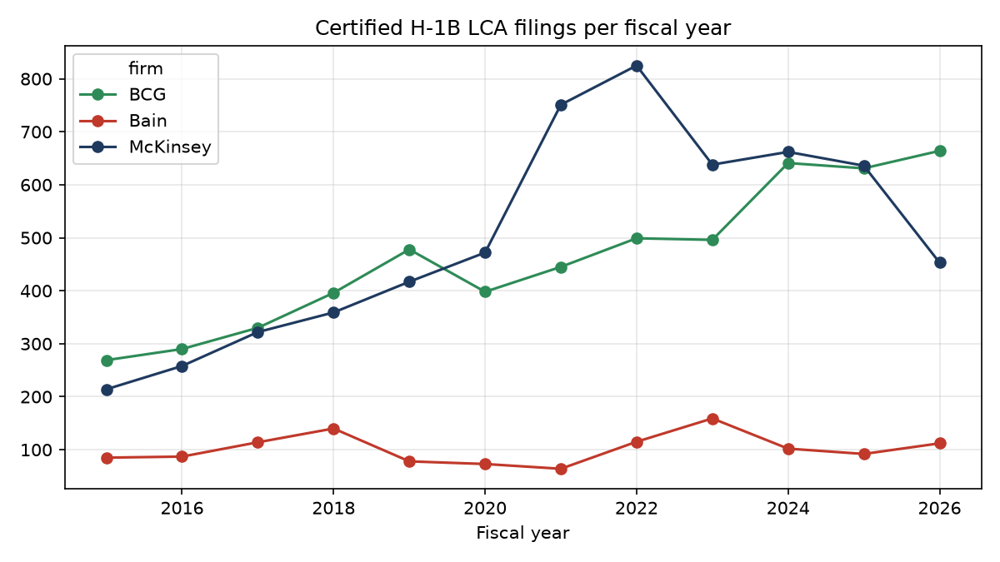
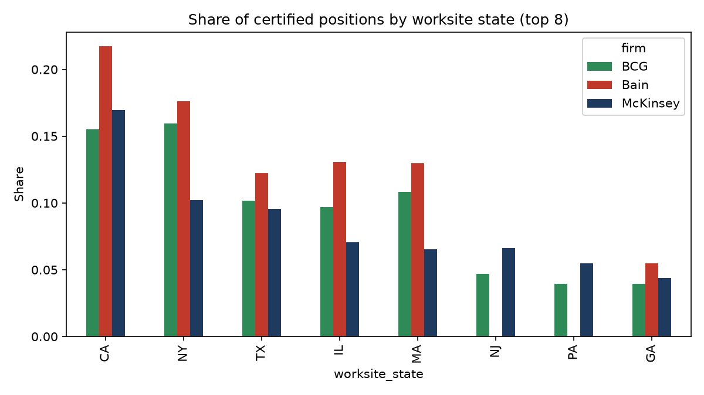
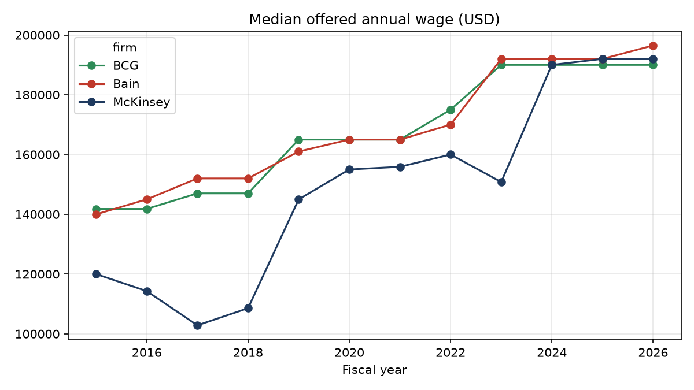

# Finding Set 1: Scale and Hiring Footprint

*Independent research using publicly available data. Not affiliated with McKinsey & Company, Boston Consulting Group or Bain & Company.*

## Question
Using one consistent public source, how do McKinsey, BCG and Bain compare on US hiring activity, growth, geographic footprint and role mix?

## Data and method
- **Source:** US Department of Labor H-1B Labor Condition Application (LCA) disclosure data, accessed via a public mirror (see [sources](../sources.md), S1).
- **Sample:** 12,949 filings (BCG 5,590; McKinsey 6,067; Bain 1,292), FY2015 to FY2026. Analysis uses **certified** filings only (11,535 for FY2015 to FY2025).
- **Pipeline:** [`src/ingest/h1b_lca.py`](../../src/ingest/h1b_lca.py) filters the three firms; [`src/legacy/analyze_scale.py`](../../src/legacy/analyze_scale.py) produces every number below.
- **Firm matching:** pattern-based on employer name (over 30 spelling variants for McKinsey alone). "Boston Consulting Solutions" is excluded as a different entity.
- **Growth rates** use FY2016 to FY2024. FY2026 is partial (data through June 2026) and is excluded from growth figures.

## What this data is, and is not
An LCA is a US employer's filing to hire a foreign-national worker on an H-1B visa. It is a **proxy for US hiring activity**. It is not headcount, revenue or global scale. Firms differ in how much they use H-1B, so **trends within a firm are more reliable than level differences between firms**.

## Findings

### 1. McKinsey and BCG file at similar volumes; Bain is far smaller
Certified filings, FY2015 to FY2025: McKinsey 5,554, BCG 4,873, Bain 1,108. Bain's volume is about 20% of McKinsey's.

### 2. McKinsey and BCG filings grew about 10 to 12% a year; Bain's grew slowly
Filing CAGR, FY2016 to FY2024: McKinsey 12.5%, BCG 10.4%, Bain 2.2%.
- McKinsey jumped in FY2021 (751 filings vs 472 in FY2020); BCG did not (445).
- Bain fell from 140 filings (FY2018) to 64 (FY2021) and has not returned to that level.

### 3. McKinsey files for many more positions per application
Average positions per filing (all filings): McKinsey 7.9, Bain 2.5, BCG 1.8. McKinsey often files batches of up to 100 positions in one application, so its position totals (about 6,200 to 6,900 a year since FY2022) are much larger than its filing count suggests. This reflects filing practice as much as hiring, so position totals should be read with care.

### 4. McKinsey has the broadest US footprint; Bain is the most concentrated
| | Worksite states | Worksite cities | State concentration (HHI) |
|---|---|---|---|
| McKinsey | 45 | 155 | 0.075 |
| BCG | 35 | 57 | 0.091 |
| Bain | 19 | 32 | 0.138 |

California, New York, Texas, Illinois and Massachusetts lead for all three firms.

### 5. Roles are overwhelmingly consulting; technical roles appear at all three, in different mixes
"Management Analysts" is the top occupation for every firm. Certified filings, FY2015 to FY2025 (from `outputs/tables/lca_top_occupations.csv`):

| Occupation | McKinsey | BCG | Bain |
|---|---|---|---|
| Management Analysts | 3,147 | 3,510 | 1,011 |
| Statisticians | 411 | n/a (not in top 8) | n/a |
| Operations Research Analysts | 287 | 270 | 9 |
| Data Scientists | 195 | 132 | 12 |
| Software Developers (incl. "Applications") | 427 | 231 | 8 |

Values shown as "n/a" fall outside the firm's top eight occupations and were not computed.

### 6. Offered wages converged upward
Median offered annual wage over the full period: BCG $165,000, Bain $152,000, McKinsey $150,055. By FY2024 and FY2025 all three sit at about $190,000 to $192,000. McKinsey started lowest (about $120,000 in FY2015) and caught up. These are offered base wages and exclude bonuses.

### 7. Prevailing wage level differs by firm, cause unclear
44% of BCG and Bain filings are at DOL wage Level III, against 28% for McKinsey, which has 43% at Level II. This is likely about how roles are classified in the filing, not about pay or seniority, and the data here cannot settle it.

## Limitations
- US-only and H-1B-only: excludes citizens, permanent residents and every non-US office.
- Filings are applications, not hires. Certification rates are high (BCG 99.1%, McKinsey 99.0%, Bain 94.4%), but not every certified role is filled.
- Differences between firms partly reflect each firm's immigration practice and counsel, not underlying growth.
- The mirror has not been independently re-checked against the original DOL files.
- Wages were annualized from the stated pay unit; values outside $30K to $1M were dropped as likely entry errors.
