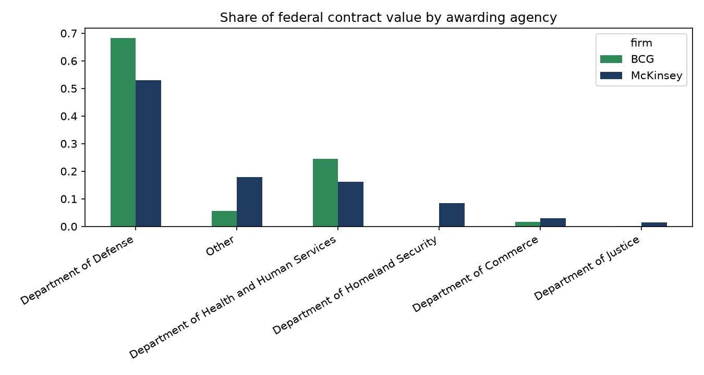
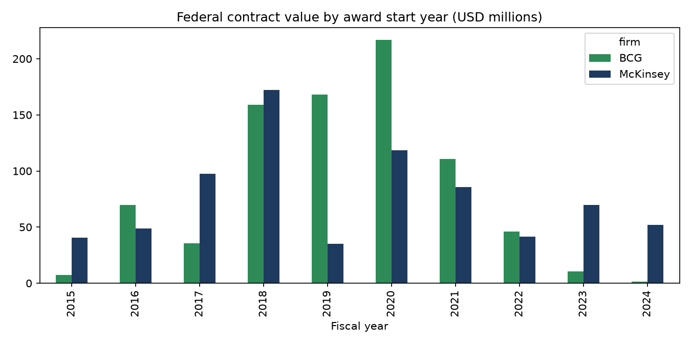

# Finding Set 2: Public-Sector Exposure

*Independent analysis using publicly available data. Not affiliated with McKinsey & Company, Boston Consulting Group or Bain & Company.*

## Question
How much direct US federal contract work does each firm hold, who buys it, and how has it changed over the decade?

## Data and method
- **Source:** [USAspending.gov](https://www.usaspending.gov) prime contract awards (contract types A to D), queried through its public API (see [sources](../sources.md), S2).
- **Pipeline:** [`src/ingest/usaspending_awards.py`](../../src/ingest/usaspending_awards.py) pulls and filters awards; [`src/legacy/analyze_public_sector.py`](../../src/legacy/analyze_public_sector.py) produces every number below.
- **Sample:** awards with a start date in FY2015 to FY2024 and a positive value: McKinsey 188, BCG 127. FY2025 is excluded as incomplete.
- **Firm matching:** by the recipient's legal-entity name. The API's text search is fuzzy and returned unrelated companies (for example "McKinsey Fencing"), which were removed.
- **Value:** the API's "Award Amount", the total obligated value of the award, attributed to the year the award *started*, not spread over its life.

## What this data is, and is not
It covers **direct (prime) US federal contracts only**. It excludes state and local government, non-US governments, and subcontract work under another prime contractor, so it understates total public-sector work, particularly for firms that mostly serve governments outside the US.

## Findings

### 1. Bain has no direct US federal contracts in this data
The search returned no prime contract awards to Bain & Company under either name variant. This does not mean Bain does no public-sector work; it means none flows through the federal prime-contract channel recorded here.

### 2. McKinsey and BCG hold federal contracts of similar total size
| FY2015 to FY2024 | Awards | Total value | Median award | Largest award |
|---|---|---|---|---|
| BCG | 127 | $826M | $2.6M | $77.1M |
| McKinsey | 188 | $762M | $1.7M | $48.8M |

BCG has fewer, larger awards; McKinsey has more, smaller ones.

### 3. Both are heavily exposed to Defense, BCG more so
Department of Defense accounts for 68% of BCG's contract value and 53% of McKinsey's. Health and Human Services is second for both (24% and 16%).

### 4. McKinsey sells to a wider set of agencies
McKinsey has awards from 19 distinct agencies versus 10 for BCG. Beyond Defense and HHS, McKinsey's top buyers are the Department of Veterans Affairs ($86M) and Homeland Security ($64M); BCG's next are USAID ($25M) and Commerce ($14M).

### 5. The work is classified as management and professional support
For both firms the dominant industry code is "Administrative Management and General Management Consulting Services" ($824M of BCG's $826M; $613M of McKinsey's $762M). The leading product-and-service category is "Support - Professional: Other", followed by program management and policy review.

### 6. Federal work peaked around FY2018 to FY2020 and has fallen since, more sharply for BCG
| Contract value ($M) | FY2018 | FY2019 | FY2020 | FY2021 | FY2022 | FY2023 | FY2024 |
|---|---|---|---|---|---|---|---|
| BCG | 158.9 | 168.1 | 216.7 | 110.9 | 46.2 | 10.6 | 1.5 |
| McKinsey | 172.4 | 35.1 | 118.7 | 85.5 | 41.5 | 69.8 | 51.9 |

BCG's FY2020 peak was $217M; by FY2024 it had two awards worth $1.5M. McKinsey's value also fell after FY2018 but recovered partially in FY2023 and FY2024. Values are lumpy because a few large awards dominate any single year.

## Limitations
- Prime federal contracts only (see above); no state, local, international or subcontract work.
- Awards are dated by start year; multi-year awards are not spread across the years they run.
- Recent years can be revised as contract modifications are reported, so the FY2022 to FY2024 declines should be treated as provisional.
- Defense and HHS dominance may partly reflect where contract-based consulting is procured, not each firm's strategic focus.
- Totals are sensitive to a few large awards; medians and counts are shown alongside to indicate this.
