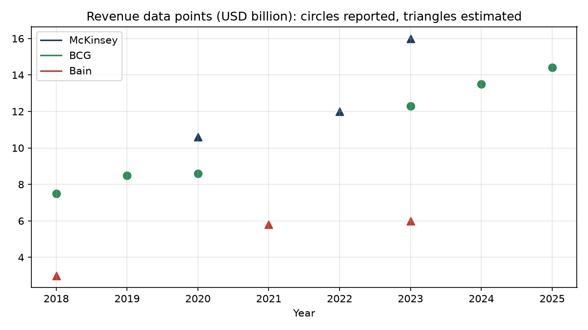

# Finding Set 3: Firm Scale and Global Reach

*Independent analysis using publicly available data. Not affiliated with McKinsey & Company, Boston Consulting Group or Bain & Company.*

## Question
How do the three firms compare on revenue, headcount and global reach, and how well can this be measured from public information?

## Data and method
- **Dataset:** [`data/clean/firm_scale_points.csv`](../../data/clean/firm_scale_points.csv), 30 hand-compiled data points. Every row carries a source URL, a **type** (reported by the firm or a regulator, versus estimated by a third party) and a **confidence** rating.
- **Script:** [`src/legacy/analyze_firm_scale.py`](../../src/legacy/analyze_firm_scale.py) computes every derived number below.
- **Rule applied:** growth rates and ratios are computed only when both end points exist for the same firm. Gaps are left as gaps, not interpolated.
- Where a source says "more than X" (offices, countries, headcount), X is recorded as a floor value.

## What this data is, and is not
Only BCG publishes revenue and headcount itself. McKinsey and Bain are private and do not publish financial statements, so their figures come from press analysis, SEC filing text and data aggregators, which often disagree. **The data supports a rigorous time series for BCG only.**

| Firm | Reported points | Estimated points |
|---|---|---|
| BCG | 16 | 0 |
| Bain | 3 | 5 |
| McKinsey | 0 | 6 |

## Findings

### 1. Only BCG's growth can be measured with reported figures
BCG (all reported by the firm):
- Revenue grew from $7.5B (2018) to $14.4B (2025), a **9.8% CAGR**.
- Headcount grew from 18,500 to 33,500 over the same period, an **8.9% CAGR**.
- Revenue per employee rose from about $405K to about $430K, so revenue grew slightly faster than headcount.
- Growth was not smooth: 2019 to 2020 added only $0.1B (8.5 to 8.6), against steep gains afterwards (12.3 to 14.4 from 2023 to 2025).

### 2. In 2023, McKinsey was larger than BCG by revenue and headcount, on estimates
| 2023 | Revenue | Headcount | Revenue per employee | Basis |
|---|---|---|---|---|
| McKinsey | about $16B | about 45,000 | about $356K | Estimated, medium confidence |
| BCG | $12.3B | 32,000 | about $384K | Reported |
| Bain | about $6B | about 19,000 | about $316K | Estimated, low confidence |

On these figures McKinsey is about 1.3 times BCG's revenue and 1.4 times its headcount, and Bain is about half BCG's revenue. Revenue per employee is similar for McKinsey and BCG and lower for Bain, but the McKinsey and Bain figures are estimates, so the gaps between firms should be read as indicative.

### 3. McKinsey's and BCG's headcount grew at a similar pace from 2018 to 2023
Headcount CAGR, 2018 to 2023: BCG 11.6% (reported), McKinsey 10.0% (estimated from a Fortune figure for 2018 and a roughly 45,000 headcount for 2023). Bain has no 2018 headcount in the data.

### 4. Bain's reported scale is not consistent across sources
Bain's headcount appears as "more than 12,000" in a 2020 SEC filing and about 19,000 in a 2023 profile, while aggregators give up to about 22,000. These come from different source types, so **no growth rate is computed for Bain headcount**. A press analysis states Bain's revenue roughly doubled from just over $3B in 2018 to about $6B in 2023; that is a single secondary claim, rated low confidence, and another aggregator puts 2023 revenue near $7B.

### 5. Global reach: McKinsey broadest, BCG and Bain overlapping in countries
| | Cities (offices) | Countries | Basis |
|---|---|---|---|
| McKinsey | 130+ | 68 | Estimated (secondary sources) |
| BCG | 100+ | 50+ | Reported (firm website) |
| Bain | 65 | 40 | Estimated (aggregator; undated boilerplate) |

Bain's 2020 SEC filing gave 59 offices in 37 countries, consistent with modest expansion to the later boilerplate figure, but one regulatory filing and one undated figure do not establish a trend. Counts are not like-for-like: firms define "office" and "country" differently, and several figures are floors.

### 6. The key finding is a transparency gap
For a decade-long comparison, public information is insufficient: there is no McKinsey or Bain revenue before 2022 in the data, BCG's 2021 and 2022 revenue was not located, and no firm has a continuous series. Anything that presents a smooth 10-year revenue line for all three is interpolating or assuming. Findings 1 and 2 are the most defensible; the rest should be treated as context.

## Limitations
- Three of the four metrics for McKinsey and Bain are estimates from secondary sources that were not independently verified against the original documents.
- BCG's 2021 and 2022 revenue was not found in the sources searched; this is a gap in this study, not necessarily in the firm's disclosures.
- Different definitions of headcount (all employees versus consultants) and of "office" may apply across sources.
- Revenue per employee is computed from point estimates and inherits their error.
