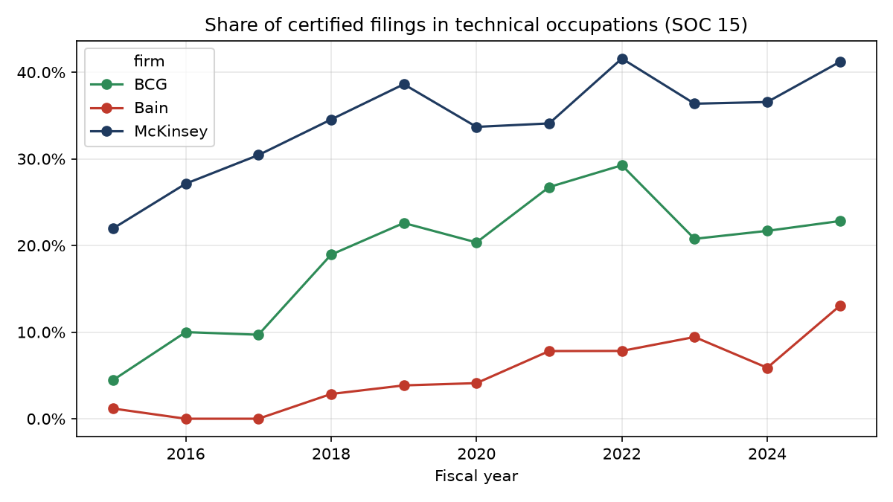

# Finding Set 4: Capability Emphasis (Technical and Analytical Roles)

*Independent analysis using publicly available data. Not affiliated with McKinsey & Company, Boston Consulting Group or Bain & Company.*

## Question
How much do the three firms' US hiring filings lean toward technical and analytical capabilities, and is that changing?

## Data and method
- **Source:** the same H-1B filings as [Set 1](01_scale_hiring_footprint.md) (see [sources](../sources.md), S1), certified filings for FY2015 to FY2025.
- **Script:** [`src/legacy/analyze_capabilities.py`](../../src/legacy/analyze_capabilities.py).
- **Proxy definition:** a filing is "technical" if its occupation code is in SOC major group 15 (Computer and Mathematical Occupations): data scientists, statisticians, software developers, operations research analysts, business intelligence analysts and similar. The comparison role is "Management Analysts" (SOC 13-1111), the standard classification for consultants.

## What this data is, and is not
This measures the mix of roles the firms sponsor, not their service lines or revenue by capability. It says nothing about industry exposure: **no public source gives industry revenue mix for these firms**, so industry exposure is not measured in this study, other than the federal-agency view in [Set 2](02_public_sector_exposure.md).

## Findings

### 1. McKinsey leans most technical; Bain least
Share of certified filings in technical occupations, FY2015 to FY2025: McKinsey 35.9%, BCG 20.3%, Bain 5.2%. Management Analysts account for most of the rest (McKinsey 56.7%, BCG 72.0%, Bain 91.2%); the remainder is other occupations.

### 2. The technical share rose at all three firms
| Technical share | FY2015 to FY2019 | FY2021 to FY2025 |
|---|---|---|
| McKinsey | 31.8% | 38.0% |
| BCG | 14.5% | 24.0% |
| Bain | 1.6% | 8.8% |

BCG's share grew by about 9.5 percentage points and McKinsey's by about 6. Bain's rose from a very low base, and its counts are small (1 technical filing in FY2015, 12 in FY2025), so its percentages move a lot on a handful of cases.

### 3. BCG's shift happened in the late 2010s; McKinsey's was steadier
BCG's share rose from 4.5% (FY2015) to 22.6% (FY2019) and peaked at 29.3% in FY2022, then eased to 22.8% in FY2025. McKinsey climbed more gradually from 22.0% to a peak of 41.6% in FY2022 and 41.2% in FY2025.

### 4. The technical roles differ by firm
Top technical occupations by filings (FY2015 to FY2025):
- **McKinsey:** statisticians (411), operations research analysts (287), software developers (245), business intelligence analysts (202), data scientists (195).
- **BCG:** operations research analysts (270), software developers (148 applications, 83 other), data scientists (132), IT project managers (103).
- **Bain:** data scientists (12), operations research analysts (9), a handful of others.

McKinsey's mix is weighted toward statistics and business intelligence, BCG's toward operations research and software.

## Limitations
- A role mix in H-1B filings reflects who needs visa sponsorship. Technical roles may be over- or under-represented relative to each firm's whole US workforce, and the extent is unknown.
- Occupation codes are chosen by the filing employer and are not a precise measure of capability.
- Firm-to-firm differences partly reflect where each firm houses technical staff (for example, in affiliated entities that file under a different employer name), which this study does not capture.
- Bain's counts are small, so its shares are volatile.
