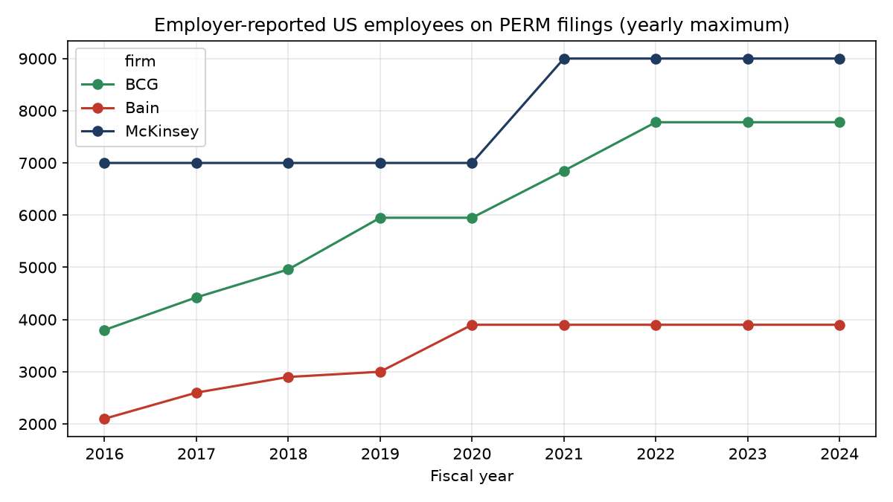

# Finding Set 6: US Workforce and Talent Profile (PERM Filings)

*Independent analysis using publicly available data. Not affiliated with McKinsey & Company, Boston Consulting Group or Bain & Company.*

## Question
What do government labor-certification filings reveal about each firm's US workforce size, the talent it sponsors for permanent residence, and how consistently it succeeds?

## Data and method
- **Source:** US Department of Labor PERM (permanent labor certification) disclosure data, via the same public mirror as Set 1 (see [sources](../sources.md), S1).
- **Sample:** 3,795 filings (McKinsey 1,868; BCG 1,508; Bain 419), FY2015 to FY2026. FY2026 is partial.
- **Script:** [`src/ingest/perm.py`](../../src/ingest/perm.py) and [`src/legacy/analyze_workforce.py`](../../src/legacy/analyze_workforce.py).
- Firm matching is on the leading employer name, because some DOL name fields lost the ampersand ("MCKINSEY  COMPANY").

## What this data is, and is not
PERM is the first step to a green card, so it covers **sponsored long-term foreign hires in the US only**. Each filing also states the employer's number of US employees. That field is filer-defined and unaudited, so it is used cautiously (see finding 1).

## Findings

### 1. A reported US headcount series exists for all three firms, FY2016 to FY2024
Individual filings sometimes report a smaller entity or office count, so the yearly **maximum** reported value is used as the firm-wide figure.

| FY | McKinsey | BCG | Bain |
|---|---|---|---|
| 2016 | 7,000 | 3,800 | 2,100 |
| 2018 | 7,000 | 4,960 | 2,900 |
| 2020 | 7,000 | 5,950 | 3,900 |
| 2022 | 9,000 | 7,780 | 3,900 |
| 2024 | 9,000 | 7,780 | 3,900 |

Growth FY2016 to FY2024: BCG 9.4% a year, Bain 8.0%, McKinsey 3.2%. McKinsey's values are rounded and step from 7,000 to 9,000, so its growth rate has low resolution. These US figures equal about 20 to 24% of the firms' global headcount in 2023 (McKinsey about 9,000 of about 45,000; BCG 7,780 of 32,000; Bain 3,900 of about 19,000), which is plausible.

### 2. BCG's US workforce grew fastest, nearly doubling
BCG went from 3,800 to 7,780 reported US employees, closing most of the gap with McKinsey (7,000 to 9,000). This is the first reported-basis view in the study that shows McKinsey growing slower than BCG, which contrasts with the faster McKinsey filing growth in [Set 1](01_scale_hiring_footprint.md): filing volume and workforce growth are different things.

### 3. McKinsey's applications almost always succeed; BCG's often do not
Outcome of PERM cases: certified 98.1% (McKinsey), 88.5% (Bain), 85.3% (BCG). BCG has 14.1% withdrawn versus 1.4% for McKinsey. Denials are under 1% for all three. Why BCG withdraws more is not in the data.

### 4. India is the largest source of sponsored talent at all three
Citizenship of sponsored workers: India 36.5% (McKinsey), 30.0% (BCG), 21.5% (Bain). China follows at McKinsey (11.6%) and BCG (8.5%); Bain's next are Canada (8.8%), the United Kingdom (7.3%) and Australia (6.6%), a more varied mix. McKinsey sponsors workers of 85 citizenships, BCG 82, Bain 44.

### 5. Education requirements differ sharply
Minimum education stated: Master's for 88.5% of McKinsey and 85.3% of Bain filings, but only 17.5% of BCG filings (82.5% Bachelor's). This is how each firm wrote its filings and says little about the people it hires.

### 6. Business degrees dominate; McKinsey names quantitative majors most
Share of filings naming each field: business 63% (Bain), 61% (BCG), 54% (McKinsey). Quantitative or engineering fields appear in 9.5% of McKinsey filings versus 3.8% (BCG) and 1.7% (Bain), consistent with the technical lean in [Set 4](04_capability_emphasis.md).

## Limitations
- Sponsored foreign nationals only; says nothing about the rest of the workforce.
- The employee-count field is filer-defined, unaudited and (for McKinsey) heavily rounded; FY2015 BCG (503) is excluded as an outlier.
- Fiscal-year 2025 onward is not used for headcount: the form changed and values drop sharply.
- Differences in withdrawal rates and education wording reflect each firm's filing practice and counsel.
